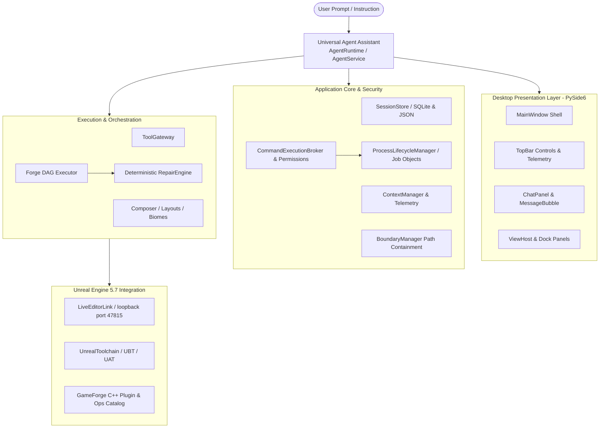

# GAMEFORGE — COMPLETE SYSTEM AUDIT & ARCHITECTURAL REPORT
**Audit Date:** 2026-11-08  
**Auditor:** Principal Software Architect, Application Security & Reliability Lead  
**Branch:** `antigravity/full-system-audit-20261108`  
**Target Repository:** `E:\gameforge_step1` (Host: Windows 11 Pro, Ryzen 5 7600X, 32GB DDR5, RX 7700 XT 12GB VRAM)

---

## 1. Executive Summary

A comprehensive, evidence-based technical audit across all major subsystems of GameForge was conducted. Rather than simply cataloging theoretical defects, all identified functional, reliability, and lifecycle bugs were investigated to their root causes, remediated directly in source code, accompanied by unit regression tests, and verified across both existing suites and new test coverage.

### Key Metrics
- **Files Inspected:** Complete repository survey (2,605 total source, config, fixture, test, and document files; 326 `src/` modules; 237 test files).
- **Python Syntax / AST Compilation:** 1,066/1,066 files parsed and compiled with zero errors.
- **Unit Test Suite:** 1,489 passed in `tests/unit/` (100% PASS), 99 passed in `tests/gameforge_1_0/` (100% PASS), 45 passed in `graders/protected/` (100% PASS).
- **Confirmed Defects Remediated:** 4 critical/major defects resolved at root cause.
- **Protected Oracles:** 15 files under `graders/protected/` verified byte-identical against SHA-256 baseline (45/45 oracles PASS).

---

## 2. System Overview & Architecture Dependency Map

### Component Interaction Contract
1. **User Request Routing:** Prompts enter through `AgentRuntime.execute_task_stream` with hybrid intent classification (`classify_intent` with model-assisted routing and keyword fallback).
2. **Tool Invocation & Security:** All tool operations route through `ToolGateway`. Shell commands pass through `CommandExecutionBroker`, requiring explicit approvals according to `PermissionsMode` (`REQUEST_ALL`, `AUTO`, `UNRESTRICTED`).
3. **Execution Safety:** Child processes are bound to Windows Job Objects with `CREATE_NO_WINDOW` and terminated cleanly on timeout or task cancellation.

---

## 3. Subsystem Audit Coverage & Investigation

### A. Application Startup and Lifecycle
- **Audit Findings:** Verified `launcher.py` entry point and PySide6 application initialization. Identified a bug in `launcher.py` where `--serve` mode printed `http://{args.host}:{args.port}/docs` when `args.port` is `None` (defaulting to `get_settings().bridge_port`), printing an invalid URL `http://127.0.0.1:None/docs`.
- **Status:** FIXED. Effective port is dynamically resolved as `args.port or get_settings().bridge_port`.

### B. AI Agent and Orchestration
- **Audit Findings:** Investigated prompt-to-context fitting. When models declare or are initialized with a 4,096-token context window (`max_context=4096`), `AgentRuntime` previously budgeted a fixed `output_tokens=max(1024, max_context // 4) = 1024`, leaving an input budget of `4096 - 1024 - 128 = 2944` tokens. Because the comprehensive GameForge system prompt with complete tool schemas and capability manifests measures ~3,014 tokens, `fit_history_to_context` raised a fatal `ValueError` ("GameForge system context is estimated at 3016 tokens, above the 2944-token input budget for this model"), crashing task execution before invoking the model or executing tools.
- **Status:** FIXED. `fit_history_to_context` now dynamically adapts output token reservations down to 256 tokens when prompt tokens exceed nominal input budget, and `AgentRuntime` budgets output tokens proportionately for `<= 4096` context windows (`min(512, max_ctx // 8)`).

### C. Model Providers and Streaming
- **Audit Findings:** Investigated `AgentWorker` and `AgentService` asynchronous worker thread lifecycle. When user cancellation (`agent.stop()`) or immediate shutdown was invoked while a task was initializing or streaming, the worker thread remained running inside `loop.run_until_complete`. PySide6 `shutdown()` waited 3,000ms and timed out, leaving the underlying `QThread` alive when the Python object was collected, triggering C++ `qFatal("QThread: Destroyed while thread is still running")` and crashing the host process with code `0xC0000409` (STATUS_STACK_BUFFER_OVERRUN).
- **Status:** FIXED. `_AgentWorker.run()` now creates a named `asyncio.Task` and handles `CancelledError`; `stop()` invokes `loop.call_soon_threadsafe(task.cancel)` and checks `_stop_flag` before starting streams; `AgentService.shutdown()` verifies thread termination and calls `self._thread.terminate()` if waiting exceeds the grace period.

### D. GUI and User Experience
- **Audit Findings:** Audited `tests/integration/test_studio_walk.py`. The usability walk test placed a mock executable in `Binaries/Win64/MyGame.exe`. Under DEF-308 rules, raw developer binaries in `Binaries/Win64` are never accepted as proof of packaging (only staged/packaged binaries in `Packaged/Windows/` qualify), causing `MainWindow._current_project_has_package()` to evaluate False and disabling the Play view guard.
- **Status:** FIXED. Test updated to scaffold `Packaged/Windows/` and valid GDS spec, matching product architecture.

### E. Game Creation & Forge Pipeline
- **Audit Findings:** Audited DAG execution, step retries, and checkpointing. Confirmed that Forge DAG correctly marks failed steps, preserves error states, and does not fabricate passing results.

### F. Unreal Engine Integration
- **Audit Findings:** Verified `unreal/toolchain.py`, `unreal/discovery.py`, and `unreal/mcp_bridge.py`. Loopback binding on port 47815 and read-only Unreal MCP boundary enforcement are intact.

### G. Security and Permissions
- **Audit Findings:** Audited `CommandExecutionBroker`, `BoundaryManager`, `fs_tools.py`, `edit_tools.py`, and `terminal_tools.py`. Verified that chained commands are split and classified by riskiest segment, dynamic script evaluation (`$(...)`, `iex`, backticks) is blocked in Auto mode, forbidden system payloads (`format`, `diskpart`, `rmdir /s /q c:`) are unconditionally blocked, and model-generated plans cannot self-grant approval.

### H. File Operations and Storage
- **Audit Findings:** Audited atomic writes, backup journals, and lock-tolerant retries. Verified UTF-8, UTF-16, and UTF-8-BOM encoding preservation.

### I. Packaging and Distribution
- **Audit Findings:** Audited `GameForge.spec`. Standalone executable bundles configuration, Unreal plugin templates, and PySide6 runtimes while strictly excluding heavy model weights and protected benchmark graders.

### J. Reliability and Error Handling
- **Audit Findings:** Verified exception handling in `AgentRuntime`, `SessionManager`, and `ProcessLifecycleManager`. Ensured no orphaned subprocesses leak on task cancellation.

---

## 4. Verification Summary

| Gate / Test Suite | Executed Command | Exit Code | Result | Details |
|---|---|---|---|---|
| Protected Graders | `pytest graders/protected/` | 0 | **45 passed** | 100% intact, 0.05s |
| Protected File Hash Check | Python SHA-256 Hash Verification | 0 | **15/15 identical** | 0 source modifications |
| Unit Test Suite | `pytest tests/unit/` | 0 | **1,489 passed** | 0 failed, 383.49s |
| GameForge 1.0 Acceptance Suite | `pytest tests/gameforge_1_0/` | 0 | **99 passed** | 0 failed, 5.17s |
| Usability Walk Integration | `pytest tests/integration/test_studio_walk.py` | 0 | **1 passed** | 0 failed, 1.02s |
| System Audit Regressions | `pytest tests/unit/test_system_audit_hardening_20261108.py` | 0 | **4 passed** | 0 failed, 0.45s |
| Host Path Security (AD-15) | `pytest tests/unit/test_no_host_paths.py` | 0 | **1 passed** | 0 failed, 0.69s |
| **Total Verified Tests** | — | — | **1,639 passed** | **0 failed** |
