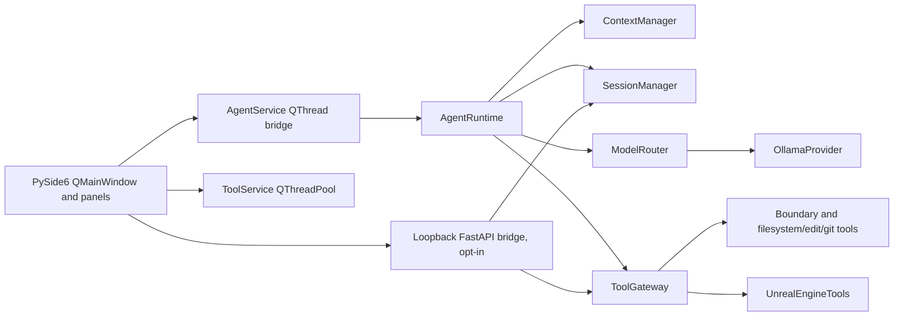

# GameForge IDE Architecture

**Status:** Verified source map, updated 2026-10-24  
**Scope:** Current native Windows application. This describes implemented code, not the larger product target.

## Runtime data flow

The normal entry point is `src/gameforge_ide/launcher.py`; it constructs a native `QApplication` and `MainWindow`. `--serve` starts the optional loopback FastAPI bridge for Unreal communication. FastAPI is not the desktop's primary UI or the local provider's transport.

## Responsibility map

| Responsibility | Source | Current boundary |
|---|---|---|
| Native desktop shell and command actions | `src/gameforge_ide/desktop/main_window.py` | QMainWindow, docks, menus, shortcuts, settings, command palette |
| Chat, explorer, diff, Unreal and terminal panels | `src/gameforge_ide/desktop/panels/` | Qt widgets; terminal is user-controlled PowerShell |
| Background UI bridges | `src/gameforge_ide/desktop/services/` | Agent QThread and tool QThreadPool; cancellation/session events guarded |
| Agent orchestration | `src/gameforge_ide/backend/agent/runtime.py` | Bounded response/tool loop, permission gate, prompt budget, event stream |
| Context and prompt construction | `src/gameforge_ide/backend/agent/context_manager.py`; `src/gameforge_ide/backend/unreal_context.py` | Canonical context summary, engine invariants, bounded Unreal metadata persistence; editor metadata is labeled untrusted |
| Provider API and routing | `src/gameforge_ide/backend/providers/` | Ollama plus OpenAI-compatible adapter/test double; remote hosted service is not implemented |
| Session persistence | `src/gameforge_ide/backend/session_manager.py` | JSON-backed sessions under workspace metadata; durable cross-process recovery not fully tested |
| Tools and permissions | `src/gameforge_ide/backend/tools/` | Typed tool definitions, workspace boundaries, central approval checks, atomic patching |
| Unreal discovery/build | `src/gameforge_ide/backend/tools/unreal_tools.py` | Engine/project discovery, bounded staged UBT build and diagnostic parsing |
| Unreal editor metadata receiver | `src/gameforge_ide/backend/app.py`; `src/gameforge_ide/backend/unreal_context.py` | Loopback routes validate bounded fields and atomically persist/read `.gameforge/unreal_context.json`; real HTTP write/read check passed |
| Unreal editor plugin | `src/gameforge_ide/unreal/GameForge/` | UE 5.7.4 Win64 package build and disposable editor module load passed; plugin menu-triggered request not verified |
| Automated evidence | `tests/unit/`, `graders/protected/` | Unit tests and protected evaluation graders; graders were not changed |

## Key decisions and observed repairs

- Native PySide6 is the primary UI. The removed browser frontend and old web-first architecture description are superseded.
- Agent tools are executed through `ToolGateway`; shell commands require explicit approval and use argv execution. The embedded PowerShell remains an explicit user terminal and is not an OS sandbox.
- Proposed edits are reviewable and bind to original/new byte hashes; stale edits and stale rollback are rejected.
- Context budgeting estimates tokens conservatively from UTF-8 bytes. The active prompt is kept whole; older whole messages are omitted from newest to oldest. This estimate is advisory and is not tokenizer-reported usage.
- The bridge is loopback-only and requires a per-run `GAMEFORGE_BRIDGE_TOKEN` bearer secret for Unreal context GET/POST. It is not exposed as a hosted API. Same-user processes may still read/inherit environment secrets; this is not OS-level process isolation.

## Known architectural gaps

There is no project-wide incremental index, attachment pipeline, durable pending-diff recovery, hosted inference service, UI code editor, automated test/build diagnostics panel, OS-level agent sandbox, bounded bridge request timeout/token rotation, or verified end-to-end live-model tool-call loop. These remain explicit follow-up work rather than claimed capabilities.
