# GameForge IDE — Master Implementation Plan (Milestones A–I)

**Document Version:** 1.0.0  
**Status:** Approved & Active  
**Authority:** Product-Priority Decision D-029  
**Execution Sequence:** Strict Linear Progression with Empirical Gate Verification  

---

## 1. Plan Overview

This plan defines the sequential implementation, validation, and release engineering sequence for the **GameForge IDE MVP** and its Unreal-first integration.

```mermaid
graph LR
    MilestoneA["Milestone A: Runnable Desktop Shell"] --> MilestoneB["Milestone B: Local Model Connection"]
    MilestoneB --> MilestoneC["Milestone C: Typed Agent Tool Loop"]
    MilestoneC --> MilestoneD["Milestone D: Review & Validation Workflow"]
    MilestoneD --> MilestoneE["Milestone E: Remote-Model Readiness"]
    MilestoneE --> MilestoneF["Milestone F: Unreal Engine 5.7 Plugin"]
    MilestoneF --> MilestoneG["Milestone G: Persistent Context & Resumability"]
    MilestoneG --> MilestoneH["Milestone H: Real 3D Asset Pipeline"]
    MilestoneH --> MilestoneI["Milestone I: End-to-End Acceptance & Release"]
```

---

## 2. Milestone Breakdown & Acceptance Gates

### Milestone A: Runnable GameForge IDE Foundation
- **Goal:** Create the desktop shell, backend server, workspace navigation, chat interface, settings panel, and persistent session manager.
- **Deliverables:**
  - `src/gameforge_ide/backend/app.py`: FastAPI server with REST endpoints (`/api/health`, `/api/workspace`, `/api/sessions`, `/api/models`, `/api/tools`, `/api/unreal`) and WebSocket streaming (`/api/ws/agent`).
  - `src/gameforge_ide/backend/session_manager.py`: Persistent session storage in `.gameforge/sessions/`.
  - `src/gameforge_ide/frontend/`: Premium dark-mode glassmorphic single-page web app (`index.html`, `style.css`, `app.js`).
  - `src/gameforge_ide/launcher.py`: Desktop application launcher.
- **Acceptance Criteria:** Application starts cleanly, workspace directory can be loaded, new sessions can be created, and UI renders interactively.

### Milestone B: Connect Local GameForge Model
- **Goal:** Integrate local Ollama instance (`gameforge-27b-sft:latest`) with streaming output and parameter controls.
- **Deliverables:**
  - `src/gameforge_ide/backend/providers/base.py`: Abstract `ModelProvider` contract and capability schemas.
  - `src/gameforge_ide/backend/providers/ollama_provider.py`: Concrete local Ollama provider with streaming SSE/WebSocket, `"think": False`, temperature/context controls, and error handling.
- **Acceptance Criteria:** Real prompt query produces streaming tokens from local `gameforge-27b-sft:latest`; sessions survive application restarts.

### Milestone C: Implement Real Agent Tool Loop
- **Goal:** Build the bounded 14-step agent runtime and typed tool gateway.
- **Deliverables:**
  - `src/gameforge_ide/backend/tools/gateway.py`: Typed tool dispatcher with security boundary.
  - `src/gameforge_ide/backend/tools/fs_tools.py`: Safe `list_dir`, `read_file`, `search_code`.
  - `src/gameforge_ide/backend/tools/terminal_tools.py`: Streamed command execution with timeout/cancellation.
  - `src/gameforge_ide/backend/tools/git_tools.py`: Git status and diff queries.
  - `src/gameforge_ide/backend/agent/runtime.py`: Bounded agent loop with state transitions and error recovery.
- **Acceptance Criteria:** Agent inspects actual workspace files, plans actions, and dispatches tools with genuine outputs.

### Milestone D: Review and Validation Workflow
- **Goal:** Implement interactive diff inspection, approval gating, atomic file patching, and rollback.
- **Deliverables:**
  - `src/gameforge_ide/backend/tools/edit_tools.py`: Unified diff generation, patch validation, file modifications, and rollback snapshots.
  - `src/gameforge_ide/frontend/`: Diff preview component with syntax highlighting and Approve/Reject buttons.
- **Acceptance Criteria:** Proposing a file change creates a readable diff; approving applies it safely with rollback data; rejecting leaves workspace untouched.

### Milestone E: Remote-Model Readiness
- **Goal:** Implement extensible remote OpenAI-compatible provider architecture without modifying agent core.
- **Deliverables:**
  - `src/gameforge_ide/backend/providers/openai_provider.py`: Configurable remote endpoint adapter reading credentials from environment variables.
  - `src/gameforge_ide/backend/providers/router.py`: Capability-aware model router.
  - Deterministic test fixtures for offline provider verification.
- **Acceptance Criteria:** Future self-hosted or cloud model can be configured via UI/settings without changing agent code; API keys remain protected.

### Milestone F: Unreal Engine 5.7 Integration
- **Goal:** Author native Unreal Engine 5.7 plugin and memory-safe staged compilation runner.
- **Deliverables:**
  - `src/gameforge_ide/unreal/GameForge/GameForge.uplugin`: Engine plugin descriptor.
  - `src/gameforge_ide/unreal/GameForge/Source/GameForgeEditor/`: C++ Editor module with `FGameForgeBridgeClient` HTTP connection.
  - `src/gameforge_ide/backend/tools/unreal_tools.py`: Engine version discovery, project parsing, and staged compilation runner.
- **Acceptance Criteria:** Engine context (version, open project, active C++ class) reaches the agent; staged compilation captures MSVC compiler errors for model self-repair.

### Milestone G: Persistent Context and Resumability
- **Goal:** Connect IDE session lifecycle to `context.md` and implement checkpoint resumability.
- **Deliverables:**
  - `src/gameforge_ide/backend/agent/context_manager.py`: Automated `context.md` ingestion, task state checkpointing, and compaction.
- **Acceptance Criteria:** Partially executed task can be resumed after application restart without losing context or repeating completed work.

### Milestone H: Real Multimodal 3D Asset Pipeline Slice
- **Goal:** Implement procedural 3D geometry generator and Unreal import metadata validator.
- **Deliverables:**
  - `src/gameforge_ide/backend/tools/asset_tools.py`: Procedural 3D mesh generator producing valid `.obj` and `.mtl` files on `E:`.
  - Unreal `.uasset` import metadata JSON generator (LODs, collision, PBR materials).
  - Validation: Real geometric integrity checks (vertices, faces, normals, bounding box).
- **Acceptance Criteria:** Generates genuine 3D mesh files on `E:` with valid Unreal import descriptors; verified by geometric validator.

### Milestone I: Integrated End-to-End Acceptance & Master Reporting
- **Goal:** Execute full user workflow and author canonical master reports.
- **Deliverables:**
  - End-to-end integration test running full loop: user prompt $\to$ plan $\to$ tool inspection $\to$ diff review $\to$ approval $\to$ file change $\to$ staged compilation $\to$ asset generation $\to$ report.
  - `GAMEFORGE_IDE_EXECUTION_LOG.md`
  - `GAMEFORGE_IDE_TEST_REPORT.md`
  - `GAMEFORGE_IDE_FINAL_REPORT.md`
  - Canonical `context.md` updated and mirrored to `E:\GameForge\context.md`.
- **Acceptance Criteria:** 100% test pass rate across unit, integration, and protected benchmark suites with zero regressions.
