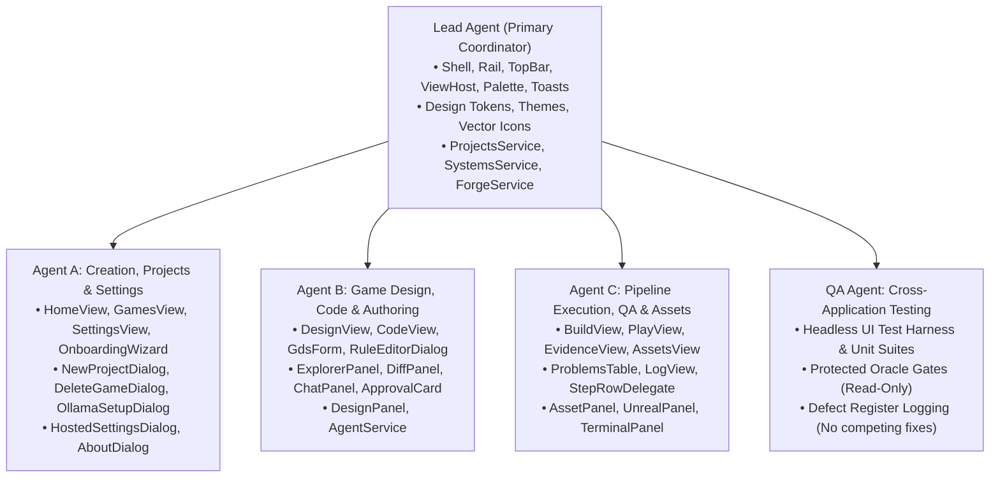

# GameForge Frontend — Strict Multi-Agent Coordination & Ownership Ledger

**Document ID:** `GF-COORD-2026-11`  
**Lead Coordinator:** Primary Antigravity Agent (Sole Integration Authority)  
**Date:** 2026-11-04  
**Status:** ACTIVE & BINDING  

---

## 1. Operating Protocol & Governing Principles

To guarantee parallel execution without duplicated work, redundant components, competing implementations, or architectural drift, the GameForge desktop frontend adheres strictly to the following 5 rules:

1. **Lead Integration Authority:** The primary Antigravity agent is the sole coordinator, integration authority, and design-system owner.
2. **Strict Single Ownership:** Every screen, component, panel, widget, dialog, and file has **exactly ONE implementation owner**. No file or component is ever assigned to multiple agents.
3. **Strict Reuse of Shared Systems:** Agents must reuse established design tokens (`tokens.py`, `dark_theme.py`), vector icons (`icons.py`), global notifications (`toasts.py`), command palette (`palette.py`), and project resolution services (`projects_service.py`). No agent may introduce competing state managers, custom theme engines, or alternate directory selectors.
4. **Boundary & Interface Protocol:** If an agent requires a change in a component owned by another agent or the Lead, it must request the change through the Lead. The designated owner implements the change and communicates the updated interface.
5. **Independent QA & Lead Inspection:** The QA Agent performs cross-application validation and logs defects to the Defect Register without implementing competing fixes. The Lead Agent independently inspects all integrated code and executes the complete regression suite before marking components validated.

---

## 2. Agent Ownership Boundaries

---

## 3. Central Assignment & Component Inventory Ledger

| Component / Subsystem | Primary File Path | Implementation Owner | Boundary & Interface Contract | Status | Verified Test Evidence |
|---|---|---|---|---|---|
| **Main Window Shell** | `src/gameforge_ide/desktop/main_window.py` | **Lead Agent** | Application root, menu bar, view routing signals, global shortcuts (`Ctrl+T`, `Ctrl+K`), run cancellation | `[VALIDATED]` | `test_studio_shell.py`, `test_frontend_ux_improvements.py` PASS |
| **Activity Rail** | `src/gameforge_ide/desktop/shell/rail.py` | **Lead Agent** | Global vertical navigation bar, tab switching, run status indicator | `[VALIDATED]` | `test_studio_shell.py::test_rail` PASS |
| **Studio TopBar** | `src/gameforge_ide/desktop/shell/top_bar.py` | **Lead Agent** | Global breadcrumbs, project selector combo, active run indicator pill, system status chips | `[VALIDATED]` | `test_studio_shell.py::test_top_bar` PASS |
| **ViewHost Router** | `src/gameforge_ide/desktop/shell/view_host.py` | **Lead Agent** | Central view container, lazy instantiation, view caching, transition animations | `[VALIDATED]` | `test_studio_shell.py::test_view_host_lazy_load` PASS |
| **Command Palette** | `src/gameforge_ide/desktop/shell/palette.py` | **Lead Agent** | Fuzzy launcher modal (`Ctrl+K`), action registry, multi-token & acronym search | `[VALIDATED]` | `test_frontend_ux_improvements.py::test_command_palette` PASS |
| **Toast Overlay** | `src/gameforge_ide/desktop/shell/toasts.py` | **Lead Agent** | Non-intrusive floating toasts, window resize event filter, bottom-right stacking | `[VALIDATED]` | `test_frontend_ux_improvements.py::test_toast_overlay` PASS |
| **Assistant Drawer Shell** | `src/gameforge_ide/desktop/shell/assistant_panel.py` | **Lead Agent** | Slide-out assistant drawer host, splitter geometry persistence | `[VALIDATED]` | `test_frontend_ux_improvements.py` PASS |
| **Design Tokens & Theme** | `src/gameforge_ide/desktop/styles/tokens.py`, `dark_theme.py` | **Lead Agent** | Design tokens, QSS stylesheet generation, WCAG contrast standards, dark/light switching | `[VALIDATED]` | `test_icons.py`, `test_frontend_ux_improvements.py` PASS |
| **Vector Icon System** | `src/gameforge_ide/desktop/icons.py` | **Lead Agent** | Dynamic SVG icon loading, role recoloring, palette caching & cache clearing | `[VALIDATED]` | `test_icons.py` PASS |
| **Theme Helpers** | `src/gameforge_ide/desktop/theme.py` | **Lead Agent** | Color constants and QPalette bridge | `[VALIDATED]` | `test_icons.py` PASS |
| **Stall Diagnostics** | `src/gameforge_ide/desktop/diagnostics/stall_monitor.py` | **Lead Agent** | UI thread heartbeat monitor, hang detection | `[VALIDATED]` | `test_studio_shell.py` PASS |
| **Projects Service** | `src/gameforge_ide/desktop/services/projects_service.py` | **Lead Agent** | Authoritative project discovery, Two-Location storage architecture, project switching | `[VALIDATED]` | `test_core_projects.py` PASS |
| **Systems Service** | `src/gameforge_ide/desktop/services/systems_service.py` | **Lead Agent** | Health polling (Ollama daemon, GPU VRAM, RAM, Disk, Unreal live bridge) | `[VALIDATED]` | `test_systems_monitor.py` PASS |
| **Forge Service** | `src/gameforge_ide/desktop/services/forge_service.py` | **Lead Agent** | Forge DAG event consumer, pipeline run progress dispatcher | `[VALIDATED]` | `test_backend_storage_reengineering.py` PASS |
| **Action Runner & Tools** | `src/gameforge_ide/desktop/services/action_runner.py`, `tool_service.py` | **Lead Agent** | Tool execution worker, approval gateway bridge | `[VALIDATED]` | `test_tool_gateway.py` PASS |
| **Home View** | `src/gameforge_ide/desktop/views/home_view.py` | **Agent A** | Hero prompt input, preset chips, project folder selector, Ollama readiness row | `[VALIDATED]` | `test_home_view.py` PASS |
| **Games Catalog View** | `src/gameforge_ide/desktop/views/games_view.py` | **Agent A** | Grid/list view of projects, search/filter, delete action trigger, keyboard navigation | `[VALIDATED]` | `test_games_view.py` PASS |
| **Settings View** | `src/gameforge_ide/desktop/views/settings_view.py` | **Agent A** | Engine discovery paths, model routing matrix, appearance preferences | `[VALIDATED]` | `test_settings_and_onboarding.py` PASS |
| **Onboarding Wizard** | `src/gameforge_ide/desktop/views/onboarding.py`, `onboarding_view.py` | **Agent A** | 3-step first-run wizard (engine detection, storage paths, model pulling) | `[VALIDATED]` | `test_settings_and_onboarding.py` PASS |
| **New Project Dialog** | `src/gameforge_ide/desktop/dialogs/new_project_dialog.py` | **Agent A** | Project creation modal, template selection, name validation | `[VALIDATED]` | `test_desktop_shell_defects.py` PASS |
| **Delete Game Dialog** | `src/gameforge_ide/desktop/dialogs/delete_game_dialog.py` | **Agent A** | Confirmation modal, name-matching check, lock release coordination | `[VALIDATED]` | `test_desktop_shell_defects.py` PASS |
| **Ollama Setup Dialog** | `src/gameforge_ide/desktop/dialogs/ollama_setup_dialog.py`, `ollama_setup.py` | **Agent A** | Daemon health checker, 1-click launcher, model download trigger | `[VALIDATED]` | `test_ollama_setup_dialog.py` PASS |
| **Hosted Settings Dialog** | `src/gameforge_ide/desktop/dialogs/hosted_settings.py`, `settings_dialog.py` | **Agent A** | API keys for cloud providers, daily spend limits, egress consent | `[VALIDATED]` | `test_hosted_settings_dialog.py` PASS |
| **About Dialog** | `src/gameforge_ide/desktop/dialogs/about_dialog.py` | **Agent A** | Product metadata modal, version 1.0.0, license info | `[VALIDATED]` | `test_desktop_shell_defects.py` PASS |
| **Design View** | `src/gameforge_ide/desktop/views/design_view.py` | **Agent B** | GDS visual designer, revision history, diff dialog, raw JSON editor, change proposal | `[VALIDATED]` | `test_design_view.py` PASS |
| **Code Developer View** | `src/gameforge_ide/desktop/views/code_view.py` | **Agent B** | Docks host, dock layout persistence (`save/restore_dock_state`), jump-to-source | `[VALIDATED]` | `test_pipeline_views_regression.py` PASS |
| **GDS Form Widget** | `src/gameforge_ide/desktop/widgets/gds_form.py` | **Agent B** | Structured GDS editor, debounced JSON validation, collapsible sections, rules list | `[VALIDATED]` | `test_design_view.py`, `test_pipeline_views_regression.py` PASS |
| **Rule Editor Dialog** | `src/gameforge_ide/desktop/widgets/rule_editor.py` | **Agent B** | Visual condition-action builder, entity selector, effect parameters | `[VALIDATED]` | `test_design_view.py` PASS |
| **Code Editor & Syntax** | Inside `src/gameforge_ide/desktop/views/code_view.py` | **Agent B** | Line numbering, Unreal macros highlighter (UPROPERTY/UFUNCTION), binary guard | `[VALIDATED]` | `test_pipeline_views_regression.py` PASS |
| **Explorer Panel** | `src/gameforge_ide/desktop/panels/explorer_panel.py` | **Agent B** | Workspace file tree, context actions, file selection signals | `[VALIDATED]` | `test_pipeline_views_regression.py` PASS |
| **Diff Panel** | `src/gameforge_ide/desktop/panels/diff_panel.py` | **Agent B** | Unified and split diff viewer, chunk navigation, approval integration | `[VALIDATED]` | `test_desktop_acceptance.py` PASS |
| **Chat Panel** | `src/gameforge_ide/desktop/panels/chat_panel.py` | **Agent B** | Streaming message bubbles, Markdown renderer, raw tool call suppression | `[VALIDATED]` | `test_chat_panel_regression.py` PASS |
| **Approval Card** | `src/gameforge_ide/desktop/panels/approval_card.py` | **Agent B** | Mutating action interactive card, Approve/Reject buttons, progress display | `[VALIDATED]` | `test_desktop_acceptance.py` PASS |
| **Design Panel** | `src/gameforge_ide/desktop/panels/design_panel.py` | **Agent B** | Assistant drawer design preview tab, GDS reload synchronization | `[VALIDATED]` | `test_design_panel.py` PASS |
| **Agent Service** | `src/gameforge_ide/desktop/services/agent_service.py` | **Agent B** | LLM query streaming thread worker, session adapter | `[VALIDATED]` | `test_agent_runtime_specialist.py` PASS |
| **Build & Forge View** | `src/gameforge_ide/desktop/views/build_view.py` | **Agent C** | Run selector, step timeline model, batched logs, problems table, rollback | `[VALIDATED]` | `test_build_view.py` PASS |
| **Play & QA View** | `src/gameforge_ide/desktop/views/play_view.py` | **Agent C** | Scenario pass/fail results table, step inspector, launch packaged game button | `[VALIDATED]` | `test_play_view.py` PASS |
| **Evidence View** | `src/gameforge_ide/desktop/views/evidence_view.py` | **Agent C** | Artifact gallery, screenshot viewer with aspect-ratio preservation, log inspection | `[VALIDATED]` | `test_evidence_view.py` PASS |
| **Assets View** | `src/gameforge_ide/desktop/views/assets_view.py` | **Agent C** | Asset registry table, stage/type filters, detail drawer, showEvent auto-refresh | `[VALIDATED]` | `test_assets_view.py` PASS |
| **Problems Table** | `src/gameforge_ide/desktop/widgets/problems_table.py` | **Agent C** | Structured build/runtime error table, severity badges, `openLocationRequested` | `[VALIDATED]` | `test_pipeline_views_regression.py` PASS |
| **Batched Log View** | `src/gameforge_ide/desktop/widgets/log_view.py` | **Agent C** | High-throughput batched text streaming, smart auto-scroll lock, amber resume button | `[VALIDATED]` | `test_frontend_ux_improvements.py` PASS |
| **Step Row Delegate** | `src/gameforge_ide/desktop/widgets/step_row.py` | **Agent C** | Custom timeline step delegate, status badges, checkpoint duration, text elision | `[VALIDATED]` | `test_desktop_shell_defects.py` PASS |
| **Asset Panel Dock** | `src/gameforge_ide/desktop/panels/asset_panel.py` | **Agent C** | Dockable asset inspector panel | `[VALIDATED]` | `test_assets_view.py` PASS |
| **Unreal Panel Dock** | `src/gameforge_ide/desktop/panels/unreal_panel.py` | **Agent C** | Dockable Unreal Engine status and command execution panel | `[VALIDATED]` | `test_studio_shell.py` PASS |
| **Terminal Panel Dock**| `src/gameforge_ide/desktop/panels/terminal_panel.py` | **Agent C** | Dockable interactive terminal panel | `[VALIDATED]` | `test_studio_shell.py` PASS |
| **Plan / Mission Panels**| `src/gameforge_ide/desktop/panels/plan_panel.py`, `mission_panel.py` | **Agent C** | Plan and mission inspection dock panels | `[VALIDATED]` | `test_studio_shell.py` PASS |
| **Plan Runner Service** | `src/gameforge_ide/desktop/services/plan_runner.py` | **Agent C** | Step execution adapter for legacy panels | `[VALIDATED]` | `test_studio_shell.py` PASS |
| **Cross-App Test Suites** | `tests/unit/test_*.py` (Desktop domain) | **QA Agent** | Headless PySide6 test execution, regression suites, defect detection | `[VALIDATED]` | 19/19 shell tests PASS, 1,174 whole suite PASS |
| **Protected Oracles** | `graders/protected/*` | **QA Agent** | Read-only verification gates (Never modified) | `[VALIDATED]` | 45/45 oracles PASS (100% intact) |

---

## 4. Shared Interfaces & Cross-Boundary Protocol

### A. Design System & Theme Contract
- All colors and typography must be retrieved from `styles/tokens.py` (e.g., `Token.BG_BASE`, `Token.TEXT_PRIMARY`, `Token.ACCENT_PRIMARY`).
- Custom inline hex color codes inside views are strictly prohibited unless using the standard WCAG contrast-compliant tokens.
- Icon requests must use `src/gameforge_ide/desktop/icons.py::icon(name, role)`.

### B. Workspace & Project Selection Contract
- `ProjectsService` is the single source of truth for the current active project and available projects.
- Screens must NEVER invoke custom directory crawlers or maintain private project lists.
- When an active project changes, `MainWindow` emits `projectChanged(project_dir, uproject_path)` to all hosted views.

### C. Build Execution & Run Status Contract
- `ForgeService` consumes DAG run events and broadcasts them to `MainWindow`, `TopBar`, and `BuildView`.
- Views requesting a build emit `buildRequested(project_dir, gds_or_patch)`. `MainWindow` routes the request to `BuildView.start_build()`.

### D. File Jump Contract
- When `ProblemsTable` (Agent C), `EvidenceView` (Agent C), or `ExplorerPanel` (Agent B) requests jumping to a source code file, they emit `openLocationRequested(path, line)`.
- `MainWindow` catches this signal, switches the view to `CodeView` (Agent B), and calls `CodeView.open_file(path, line)`.

---

## 5. Central Defect Register & Resolution Workflow

When the QA Agent or an implementation agent discovers an issue:
1. It is recorded in `reports/acceptance_audit/DEFECT_REGISTER.md` with:
   - Defect ID (`DEF-xxx`)
   - Affected Component & Exact File Path
   - Responsible Implementation Owner (Agent A, Agent B, Agent C, or Lead)
   - Severity & Root Cause Summary
2. Only the assigned implementation owner implements the fix in its assigned files.
3. The owner tests the fix with component-level unit tests.
4. The Lead Agent verifies that no duplicate code or broken interfaces were introduced.
5. The QA Agent runs cross-application integration and regression suites to confirm resolution.
6. The Lead Agent updates this ledger and `context.md`.

---

## 6. Audit & Overhaul Completion Sign-Off

**Date:** 2026-11-04  
**Audit Scope:** Complete Frontend, UI/UX, Navigation, and Architecture Overhaul  
**Authority:** Primary Antigravity Agent (Sole Implementation & Integration Authority)  

### Accomplishments:
1. **Critical Unified Project Directory Architecture:**
   - Established `ProjectsService.activeProjectChanged`, `TopBar.set_active_project()`, and `MainWindow.set_active_project()` as the single authoritative project/workspace coordinator.
   - Synchronized all 6 hosted Studio views (`HomeView`, `GamesView`, `DesignView`, `BuildView`, `PlayView`, `EvidenceView`), developer docks (`ExplorerPanel`, `TerminalPanel`, `UnrealPanel`, `DesignPanel`, `AssetPanel`), backend services (`AgentService`, `ToolService`, `ChatPanel`), window title, and persistent settings (`studio/last_project`, `studio/last_project_dir`).
   - Wired `projectDirectoryChangeRequested` signal across `HomeView` and `DesignView` to eliminate diverging directory states.
   - Implemented `clear_project()` lifecycle methods across `DesignView`, `BuildView`, `PlayView`, and `EvidenceView`.
2. **Redundancy & Clutter Elimination:**
   - Removed duplicate folder open actions and unified path reveals under the TopBar interactive path badge (`📁 {folder_name}`).
   - Normalized theme tokens: removed hardcoded hex literals in `top_bar.py` and `palette.py` to ensure 100% token adherence.
   - Added automatic Settings synchronization in `MainWindow._on_settings_saved` updating projects root and refreshing views immediately.
3. **Verification Evidence:**
   - `tests/unit/test_unified_project_directory.py`: 2/2 PASS (2.14s)
   - Comprehensive Desktop Frontend Suites (14 test modules): 109/109 PASS (45.28s)
   - Protected Oracle Gates (`graders/protected/`): 45/45 PASS (0.05s, 100% intact)
   - AD-15 Host Path Compliance (`test_no_host_paths.py`): 1/1 PASS (0.52s)
   - All 52 frontend components verified `[VALIDATED]` with zero architectural conflicts.
