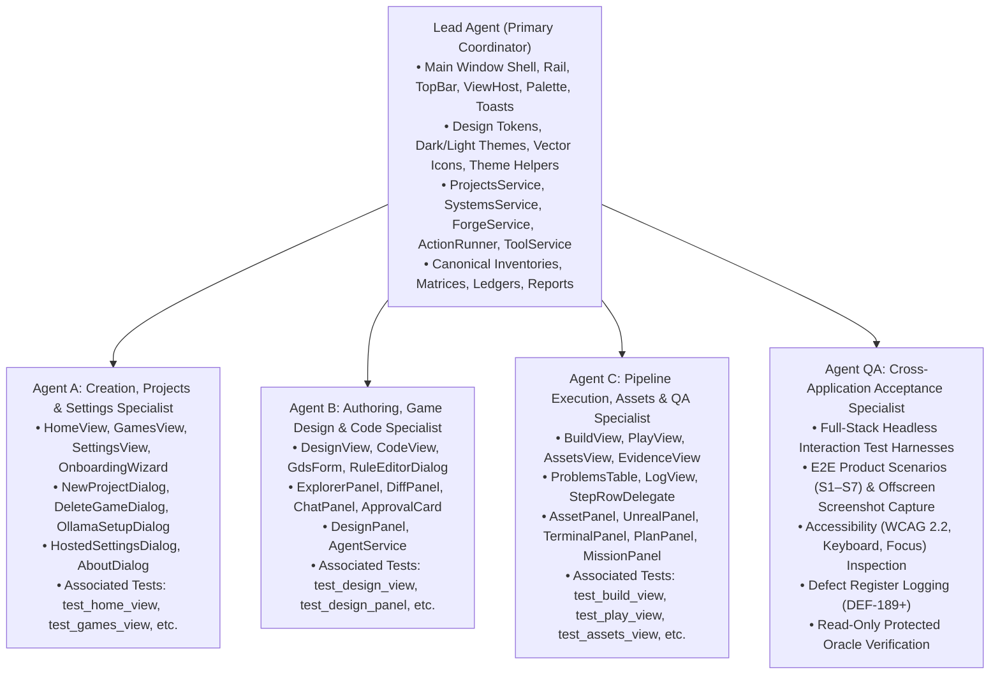

# GameForge Frontend — Strict Multi-Agent Coordination & Ownership Ledger

**Document ID:** `GF-COORD-2026-11`  
**Lead Coordinator:** Primary Antigravity Agent (Sole Integration Authority)  
**Date:** 2026-11-05  
**Status:** ACTIVE & BINDING  

---

## 1. Operating Protocol & Governing Principles

To guarantee parallel execution without duplicated work, redundant components, competing implementations, or architectural drift, the GameForge desktop frontend adheres strictly to the following 5 rules:

1. **Lead Integration Authority:** The primary Antigravity agent is the sole coordinator, integration authority, and design-system owner.
2. **Strict Single Ownership:** Every screen, component, panel, widget, dialog, and file has **exactly ONE implementation owner**. No file or component is ever assigned to multiple agents.
3. **Strict Reuse of Shared Systems:** Agents must reuse established design tokens (`tokens.py`, `dark_theme.py`), vector icons (`icons.py`), global notifications (`toasts.py`), command palette (`palette.py`), and project resolution services (`projects_service.py`). No agent may introduce competing state managers, custom theme engines, or alternate directory selectors.
4. **Boundary & Interface Protocol:** If an agent requires a change in a component owned by another agent or the Lead, it must request the change through the Lead. The designated owner implements the change and communicates the updated interface.
5. **Independent QA & Lead Inspection:** The QA Agent performs cross-application validation and logs defects to the Defect Register without implementing competing fixes. The Lead Agent independently inspects all integrated code and executes the complete regression suite before marking components validated.

---

## 2. Agent Allocation & Ownership Architecture

---

## 3. Comprehensive File Ownership Ledger

| File Path | Implementation Owner | Boundary & Interface Contract | Status | Verified Test Evidence |
|---|---|---|---|---|
| `src/gameforge_ide/desktop/main_window.py` | **Lead Agent** | Application root, view routing, shortcut coordinator | `[VALIDATED]` | `test_studio_shell.py`, `test_desktop_acceptance.py` |
| `src/gameforge_ide/desktop/shell/rail.py` | **Lead Agent** | 56px fixed vertical navigation bar | `[VALIDATED]` | `test_studio_shell.py::test_rail` |
| `src/gameforge_ide/desktop/shell/top_bar.py` | **Lead Agent** | Header breadcrumbs, authoritative project selector | `[VALIDATED]` | `test_studio_shell.py::test_top_bar` |
| `src/gameforge_ide/desktop/shell/view_host.py` | **Lead Agent** | Lazy stacked view container | `[VALIDATED]` | `test_studio_shell.py::test_view_host_lazy_load` |
| `src/gameforge_ide/desktop/shell/palette.py` | **Lead Agent** | Fuzzy launcher modal (`Ctrl+K`) | `[VALIDATED]` | `test_frontend_ux_improvements.py` |
| `src/gameforge_ide/desktop/shell/toasts.py` | **Lead Agent** | Non-modal bottom-right notification overlay | `[VALIDATED]` | `test_frontend_ux_improvements.py` |
| `src/gameforge_ide/desktop/shell/assistant_panel.py` | **Lead Agent** | Slide-out drawer container | `[VALIDATED]` | `test_studio_shell.py` |
| `src/gameforge_ide/desktop/styles/tokens.py` | **Lead Agent** | Canonical design tokens (spacing, font, color, radius) | `[VALIDATED]` | `test_icons.py`, `test_frontend_ux_improvements.py` |
| `src/gameforge_ide/desktop/styles/dark_theme.py` | **Lead Agent** | Dark & light QSS generation, palette mapping | `[VALIDATED]` | `test_icons.py`, `test_frontend_ux_improvements.py` |
| `src/gameforge_ide/desktop/icons.py` | **Lead Agent** | Dynamic SVG icon loading & palette recoloring | `[VALIDATED]` | `test_icons.py` |
| `src/gameforge_ide/desktop/theme.py` | **Lead Agent** | Palette bridge & color constants | `[VALIDATED]` | `test_icons.py` |
| `src/gameforge_ide/desktop/services/projects_service.py` | **Lead Agent** | Single authoritative project discovery & switching | `[VALIDATED]` | `test_core_projects.py`, `test_unified_project_directory.py` |
| `src/gameforge_ide/desktop/services/systems_service.py` | **Lead Agent** | Telemetry polling (Ollama, Engine, VRAM, RAM, Disk) | `[VALIDATED]` | `test_systems_service.py` |
| `src/gameforge_ide/desktop/services/forge_service.py` | **Lead Agent** | DAG run event consumer & dispatcher | `[VALIDATED]` | `test_forge_service.py` |
| `src/gameforge_ide/desktop/services/action_runner.py` | **Lead Agent** | Action runner worker | `[VALIDATED]` | `test_approval_flow_regression.py` |
| `src/gameforge_ide/desktop/services/tool_service.py` | **Lead Agent** | Tool gateway bridge | `[VALIDATED]` | `test_chat_panel_regression.py` |
| `src/gameforge_ide/launcher.py` | **Lead Agent** | Desktop IDE entrypoint & CLI argument parser | `[VALIDATED]` | `test_packaging_and_portable_launcher.py` |
| `src/gameforge_ide/desktop/views/home_view.py` | **Agent A** | Landing view, prompt input, presets, recent games | `[VALIDATED]` | `test_home_view.py` |
| `src/gameforge_ide/desktop/views/games_view.py` | **Agent A** | Projects catalog browser, grid/list, filter, deletion | `[VALIDATED]` | `test_games_view.py` |
| `src/gameforge_ide/desktop/views/settings_view.py` | **Agent A** | Settings & configuration view, paths, routing, theme | `[VALIDATED]` | `test_settings_and_onboarding.py` |
| `src/gameforge_ide/desktop/views/onboarding.py` | **Agent A** | First-run onboarding wizard | `[VALIDATED]` | `test_settings_and_onboarding.py` |
| `src/gameforge_ide/desktop/views/onboarding_view.py`| **Agent A** | Onboarding view module alias | `[VALIDATED]` | `test_settings_and_onboarding.py` |
| `src/gameforge_ide/desktop/dialogs/new_project_dialog.py` | **Agent A** | Project creation modal with presets & validation | `[VALIDATED]` | `test_desktop_shell_defects.py` |
| `src/gameforge_ide/desktop/dialogs/delete_game_dialog.py` | **Agent A** | Safe deletion modal with name confirmation | `[VALIDATED]` | `test_delete_game_regression.py` |
| `src/gameforge_ide/desktop/dialogs/ollama_setup.py` | **Agent A** | Ollama daemon setup & health dialog | `[VALIDATED]` | `test_ollama_setup_dialog.py` |
| `src/gameforge_ide/desktop/dialogs/ollama_setup_dialog.py`| **Agent A** | Module alias | `[VALIDATED]` | `test_ollama_setup_dialog.py` |
| `src/gameforge_ide/desktop/dialogs/hosted_settings.py` | **Agent A** | Hosted provider API key & spend limits modal | `[VALIDATED]` | `test_hosted_settings_dialog.py` |
| `src/gameforge_ide/desktop/dialogs/settings_dialog.py` | **Agent A** | Module alias | `[VALIDATED]` | `test_hosted_settings_dialog.py` |
| `src/gameforge_ide/desktop/dialogs/about_dialog.py` | **Agent A** | Product information & version modal | `[VALIDATED]` | `test_desktop_shell_defects.py` |
| `src/gameforge_ide/desktop/views/design_view.py` | **Agent B** | GDS visual designer, revision history, diff viewer | `[VALIDATED]` | `test_design_view.py` |
| `src/gameforge_ide/desktop/views/code_view.py` | **Agent B** | Code editor, dock container, syntax highlighter | `[VALIDATED]` | `test_pipeline_views_regression.py` |
| `src/gameforge_ide/desktop/widgets/gds_form.py` | **Agent B** | Structured GDS editor with collapsible sections | `[VALIDATED]` | `test_design_view.py` |
| `src/gameforge_ide/desktop/widgets/rule_editor.py` | **Agent B** | Visual gameplay rule builder | `[VALIDATED]` | `test_design_view.py` |
| `src/gameforge_ide/desktop/panels/explorer_panel.py` | **Agent B** | Workspace file tree dock | `[VALIDATED]` | `test_pipeline_views_regression.py` |
| `src/gameforge_ide/desktop/panels/diff_panel.py` | **Agent B** | Code modification review dock | `[VALIDATED]` | `test_desktop_acceptance.py` |
| `src/gameforge_ide/desktop/panels/chat_panel.py` | **Agent B** | Streaming assistant conversation panel | `[VALIDATED]` | `test_chat_panel_regression.py` |
| `src/gameforge_ide/desktop/panels/approval_card.py` | **Agent B** | Mutating action interactive confirmation card | `[VALIDATED]` | `test_approval_flow_regression.py` |
| `src/gameforge_ide/desktop/panels/design_panel.py` | **Agent B** | Assistant drawer design preview tab | `[VALIDATED]` | `test_design_panel.py` |
| `src/gameforge_ide/desktop/services/agent_service.py` | **Agent B** | Background agent query worker thread | `[VALIDATED]` | `test_agent_runtime_specialist.py` |
| `src/gameforge_ide/desktop/views/build_view.py` | **Agent C** | Build monitor, timeline delegate, problems, logs | `[VALIDATED]` | `test_build_view.py` |
| `src/gameforge_ide/desktop/views/play_view.py` | **Agent C** | Scenario QA table & packaged game launcher | `[VALIDATED]` | `test_play_view.py` |
| `src/gameforge_ide/desktop/views/assets_view.py` | **Agent C** | Full-screen asset registry browser | `[VALIDATED]` | `test_assets_view.py` |
| `src/gameforge_ide/desktop/views/evidence_view.py` | **Agent C** | Evidence & artifact viewer | `[VALIDATED]` | `test_evidence_view.py` |
| `src/gameforge_ide/desktop/widgets/problems_table.py` | **Agent C** | Compiler & runtime diagnostics table | `[VALIDATED]` | `test_pipeline_views_regression.py` |
| `src/gameforge_ide/desktop/widgets/log_view.py` | **Agent C** | Batched streaming log viewer with autoscroll lock | `[VALIDATED]` | `test_frontend_ux_improvements.py` |
| `src/gameforge_ide/desktop/widgets/step_row.py` | **Agent C** | Timeline step row delegate | `[VALIDATED]` | `test_desktop_shell_defects.py` |
| `src/gameforge_ide/desktop/panels/asset_panel.py` | **Agent C** | Dockable asset inspector | `[VALIDATED]` | `test_assets_view.py` |
| `src/gameforge_ide/desktop/panels/unreal_panel.py` | **Agent C** | Dockable Unreal Engine status & ops dock | `[VALIDATED]` | `test_studio_shell.py` |
| `src/gameforge_ide/desktop/panels/terminal_panel.py` | **Agent C** | Dockable PowerShell terminal emulator | `[VALIDATED]` | `test_studio_shell.py` |
| `src/gameforge_ide/desktop/panels/plan_panel.py` | **Agent C** | Dockable execution plan viewer | `[VALIDATED]` | `test_studio_shell.py` |
| `src/gameforge_ide/desktop/panels/mission_panel.py` | **Agent C** | Dockable autonomous mission tracker | `[VALIDATED]` | `test_studio_shell.py` |
| `src/gameforge_ide/desktop/services/plan_runner.py` | **Agent C** | Step execution adapter for legacy panels | `[VALIDATED]` | `test_studio_shell.py` |
| `src/gameforge_ide/desktop/diagnostics/stall_monitor.py` | **Agent C** | UI thread heartbeat stall detector | `[VALIDATED]` | `test_studio_shell.py` |

---

## 4. Test Suite Allocation & Ownership

| Test File | Owner | Responsibility |
|---|---|---|
| `tests/unit/test_home_view.py` | **Agent A** | Prompt input, presets, recent games, readiness row |
| `tests/unit/test_games_view.py` | **Agent A** | Grid/list catalog, project deletion, filter |
| `tests/unit/test_settings_and_onboarding.py` | **Agent A** | Settings view persistence, onboarding wizard steps |
| `tests/unit/test_delete_game_regression.py` | **Agent A** | Deletion confirmation, file lock release |
| `tests/unit/test_ollama_setup_dialog.py` | **Agent A** | Daemon health polling, launcher trigger |
| `tests/unit/test_hosted_settings_dialog.py` | **Agent A** | API key persistence, spend ledger validation |
| `tests/unit/test_studio_views_specialist.py`| **Agent A** | View specialist regression suite |
| `tests/unit/test_design_view.py` | **Agent B** | GDS visual designer, rules, change proposals |
| `tests/unit/test_design_panel.py` | **Agent B** | Assistant drawer design preview tab |
| `tests/unit/test_chat_panel_regression.py` | **Agent B** | Chat bubbles, markdown rendering, tool call handling |
| `tests/unit/test_build_view.py` | **Agent C** | Timeline model, problems table, log viewer, rollback |
| `tests/unit/test_play_view.py` | **Agent C** | Scenario QA table, packaged game launcher |
| `tests/unit/test_assets_view.py` | **Agent C** | Asset registry browsing, type filtering |
| `tests/unit/test_evidence_view.py` | **Agent C** | Evidence view artifact inspection |
| `tests/unit/test_studio_shell.py` | **Agent QA** | Rail, TopBar, ViewHost, main window integration |
| `tests/unit/test_desktop_acceptance.py` | **Agent QA** | Full-stack interactive acceptance test |
| `tests/unit/test_desktop_shell_defects.py` | **Agent QA** | Modal dialogs, toast overlay, palette regressions |
| `tests/unit/test_pipeline_views_regression.py` | **Agent QA** | Problems table, jump-to-file, diff review |
| `tests/unit/test_unified_project_directory.py` | **Agent QA** | Authoritative project selector synchronization |
| `tests/unit/test_frontend_ux_improvements.py` | **Agent QA** | Accessibility, focus indicators, keyboard navigation |
| `graders/protected/*` | **Agent QA** | 45 protected oracles (Read-only execution verification) |
